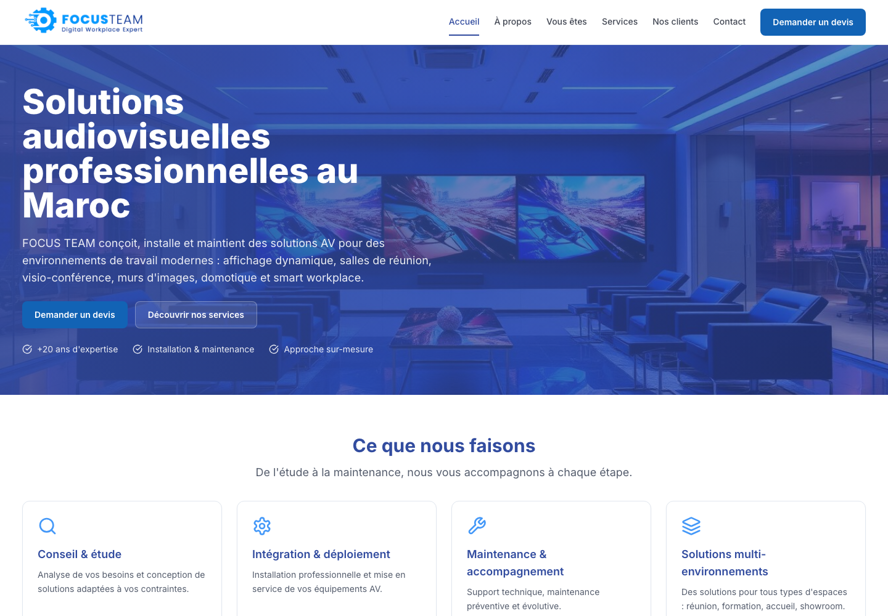
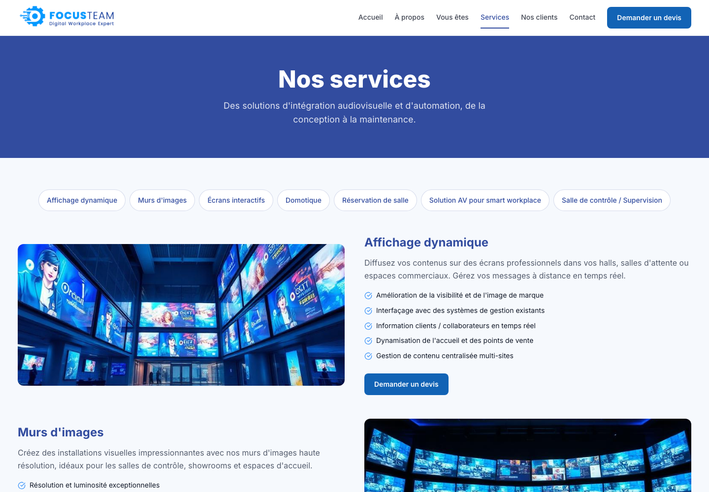
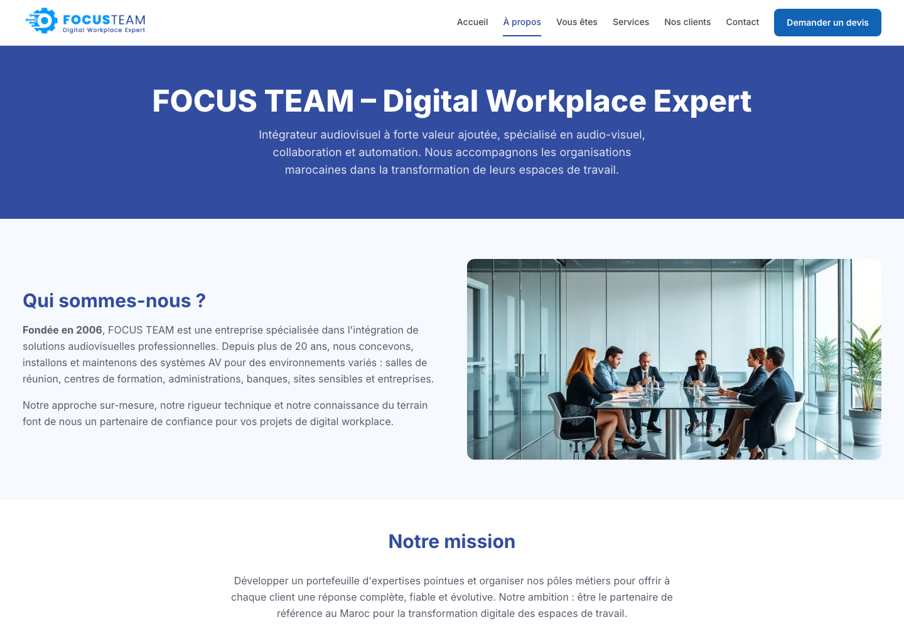
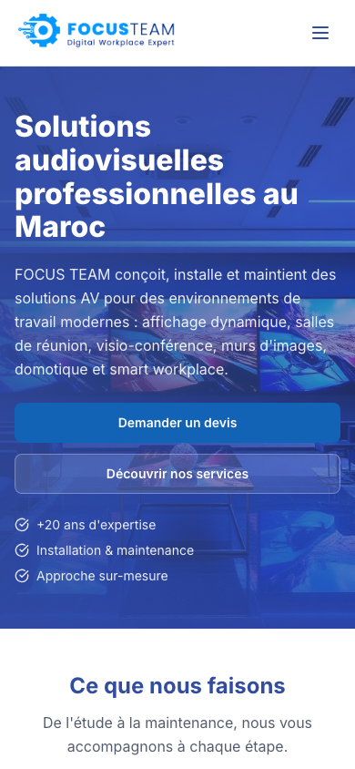

# Focus Team — Digital Workplace Expert

Site institutionnel conçu et développé pour **Focus Team**, intégrateur audiovisuel et digital workplace basé au Maroc. Cette étude de cas présente une expérience web responsive qui structure une offre technique étendue, valorise l’expertise de l’entreprise et guide les visiteurs vers une demande de devis.

[Voir le site en ligne](https://www.focusteam.ma/)

## Contexte client

Focus Team accompagne les organisations marocaines dans la conception, l’installation et la maintenance de solutions audiovisuelles professionnelles. Le projet devait traduire ce savoir-faire technique dans une interface claire, crédible et accessible à plusieurs profils de clients.

Les objectifs du projet étaient de :

- présenter immédiatement le positionnement de Focus Team au Maroc ;
- organiser les expertises et les solutions dans des parcours faciles à comprendre ;
- adapter le discours aux différents environnements professionnels ;
- faciliter la prise de contact et la demande de devis ;
- proposer une expérience cohérente sur ordinateur, tablette et mobile.

## Expérience proposée

- **Accueil immersif** avec une proposition de valeur directe et des appels à l’action visibles.
- **Catalogue de services** couvrant l’affichage dynamique, les murs d’images, les écrans interactifs, la domotique, la réservation de salles, le smart workplace et les salles de contrôle.
- **Parcours par profil client** pour contextualiser les besoins et les solutions recommandées.
- **Présentation institutionnelle** de l’entreprise, de sa mission et de ses domaines d’expertise.
- **Références clients** réunies dans une page dédiée.
- **Navigation responsive** avec une expérience adaptée aux petits écrans.
- **Thèmes clair, sombre et système** avec des repères visuels cohérents.
- **Animations et transitions** qui accompagnent la lecture sans ralentir l’accès au contenu.
- **Assistant conversationnel** en français, contextualisé à partir des services et profils clients.

## Galerie

| Catalogue des services | Présentation de Focus Team |
| --- | --- |
|  |  |

### Expérience mobile

  

## Choix UI/UX

L’identité visuelle utilise un bleu profond associé à des surfaces claires et à une typographie affirmée. Les grands titres installent immédiatement le positionnement de la marque, tandis que les cartes, onglets et appels à l’action rendent les offres techniques plus faciles à parcourir.

La hiérarchie reste stable sur toutes les tailles d’écran. Sur mobile, la navigation est condensée et les actions occupent toute la largeur disponible. Les visuels métiers renforcent le contexte sans remplacer les explications essentielles.

## Stack technique

| Domaine | Technologies |
| --- | --- |
| Interface | React 19, TypeScript |
| Build | Vite 8 |
| Styles | Tailwind CSS 4, CSS personnalisé |
| Animations | Motion, Framer Motion, Lightswind |
| Navigation | React Router |
| Validation | Zod |
| Icônes | Lucide React |
| Assistant IA | OpenCode Zen, streaming SSE |

## Pages principales

| Route | Contenu |
| --- | --- |
| `/` | Accueil et proposition de valeur |
| `/a-propos` | Entreprise, mission, expertises et valeurs |
| `/vous-etes` | Parcours par profil client |
| `/vous-etes/:slug` | Détail d’un profil et de ses besoins |
| `/services` | Catalogue détaillé des solutions |
| `/nos-clients` | Références clients |
| `/contact` | Coordonnées et demande de devis |

## Validation visuelle

Les captures de cette étude de cas proviennent de la version publique [www.focusteam.ma](https://www.focusteam.ma/). Les vues ont été contrôlées dans Chrome à 1440 × 1000 px et 390 × 844 px. Aucun débordement horizontal n’a été constaté sur les pages présentées.

## Périmètre et confidentialité

Ce dépôt public contient uniquement la documentation portfolio et des captures du site accessible publiquement. **Le code source et son historique restent dans un dépôt privé**, car le projet a été développé pour un client.

Le formulaire de contact affiché par l’interface simule actuellement la confirmation côté client. L’assistant conversationnel dépend également d’un service externe configuré séparément. Aucun secret, identifiant client ou fichier source n’est publié ici.

Les éléments de marque, contenus et coordonnées appartiennent à Focus Team et à leurs propriétaires respectifs.

---

**Projet client réalisé au Maroc — conception et développement d’un site institutionnel pour un intégrateur audiovisuel et digital workplace.**
